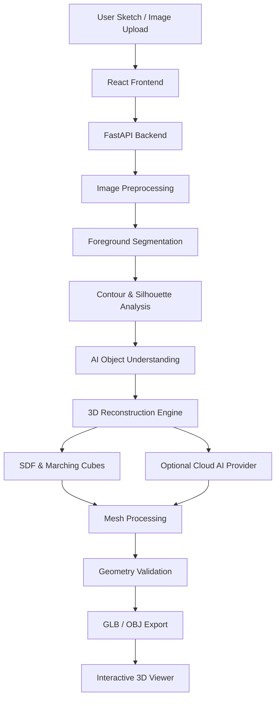

 <p align="center">
  
</p>

<h1 align="center">🎨 SKETCH2SHAPE AI</h1>

<h3 align="center">From a Simple Sketch to a Dimensional Reality.</h3>

<p align="center">
  An AI-powered 2D Sketch Understanding and 3D Reconstruction Platform.
</p>

<p align="center">
  <b>TECHZEPHYR 4.0 | IIT Bhubaneswar ML Hackathon</b>
</p>

<p align="center">
  
  
  
  
  
  
</p>

---

## 📘 Overview

**SKETCH2SHAPE AI** is an intelligent sketch-to-3D reconstruction platform designed to transform simple 2D hand-drawn sketches into interactive three-dimensional models.

The project combines **Computer Vision, AI-powered object understanding, volumetric geometry reconstruction, and real-time 3D visualization** to simplify the process of converting creative ideas into digital 3D assets.

Traditionally, creating 3D models requires specialized modeling software, technical expertise, and considerable manual effort.

SKETCH2SHAPE AI aims to bridge this gap by introducing an intelligent workflow where users can simply draw an object or upload an existing sketch, provide optional natural-language instructions, and generate a corresponding 3D representation.

Our vision is simple:

> **Make 3D creation accessible by turning imagination into geometry.**

🔗 **GitHub Repository:** [Add Repository Link]

🌐 **Live Demo:** [Add Deployment Link]

🎥 **Project Demonstration:** [Add Demo Video Link]

---

## 💡 The Problem

Transforming a simple 2D drawing into a meaningful 3D object is a challenging process.

Some of the major limitations of traditional workflows include:

* **Technical Complexity:** Professional 3D modeling software requires specialized knowledge and experience.
* **Time Consumption:** Converting conceptual drawings into 3D geometry involves multiple manual operations.
* **Accessibility:** Beginners and students may struggle to translate their ideas into three-dimensional objects.
* **Geometric Interpretation:** A 2D sketch contains limited information about depth, volume, and hidden surfaces.
* **Design Workflow:** Moving from an initial concept to a usable 3D asset can be time-consuming.

### 🚀 Our Solution

SKETCH2SHAPE AI introduces an AI-assisted workflow that combines image preprocessing, object understanding, and 3D reconstruction.

**Draw → Analyze → Understand → Reconstruct → Visualize → Export**

The objective is to reduce the complexity of 3D creation while maintaining the recognizable structure and important characteristics of the original sketch.

---

## ✨ Key Features

### 🎨 1. Interactive Sketching Studio

* Draw directly inside the browser using an interactive HTML5 canvas.
* High-resolution drawing support.
* Adjustable brush size and eraser.
* Multiple color options and custom color selection.
* Multi-level Undo and Redo.
* Multiple canvas backgrounds.
* Export sketches as PNG images.

### 📤 2. Intelligent Image Upload

* Drag-and-drop image uploading.
* Supports PNG, JPG, and WEBP formats.
* Image size and format validation.
* Live image preview.
* Replace and remove uploaded images.
* Image preprocessing before reconstruction.

### 🧠 3. AI-Powered Object Understanding

* Analyze uploaded sketches using the configured Vision AI integration.
* Identify object categories and relevant structural characteristics.
* Interpret optional natural-language instructions.
* Extract semantic information to guide the reconstruction process.
* Support an extensible AI integration architecture.

### ⚙️ 4. 3D Geometry Reconstruction

* Convert processed sketch information into volumetric representations.
* Signed Distance Field (SDF)-based geometry processing.
* Marching Cubes surface extraction.
* Mesh generation and refinement.
* Geometry validation and smoothing.
* Optional cloud-based generative reconstruction through Tripo3D when configured.

### 🧊 5. Interactive 3D Model Studio

* Real-time 3D model visualization.
* Rotate, zoom, and pan controls.
* Automatic model rotation.
* Ground grid visualization.
* Wireframe inspection.
* Studio lighting.
* Camera reset.
* Geometry statistics and bounding-box information.

### 💾 6. Model Export and Creation History

* Export generated models as `.glb`.
* Export generated models as `.obj`.
* Persistent creation history.
* Preview previously generated creations.
* Reopen models in the 3D studio.
* Download previously generated assets.
* Manage and delete saved creations.

---

## 🏗️ System Architecture

SKETCH2SHAPE AI follows a modular client-server architecture that separates frontend interaction, backend processing, AI integration, reconstruction, and 3D visualization.

### 🔄 Complete Workflow



### 🧩 Architecture Components

| Component             | Responsibility                             |
| --------------------- | ------------------------------------------ |
| React Frontend        | User interface and interaction             |
| HTML5 Canvas          | Sketch creation                            |
| FastAPI Backend       | API and processing coordination            |
| OpenCV                | Image preprocessing                        |
| Vision AI             | Semantic object understanding              |
| Reconstruction Engine | 3D geometry generation                     |
| SciPy / scikit-image  | Distance transforms and surface extraction |
| Trimesh               | Mesh processing and validation             |
| Three.js              | Interactive 3D visualization               |
| Asset Storage         | Generated model persistence                |

---

## 🛠️ Technology Stack

### Frontend Development

* **React** — Component-based UI development.
* **TypeScript** — Type-safe application development.
* **Vite** — Fast development and production build tooling.
* **Tailwind CSS** — Modern responsive styling.
* **Three.js** — 3D rendering.
* **React Three Fiber** — React-based 3D visualization.

### Backend Development

* **Python** — Core backend and reconstruction logic.
* **FastAPI** — High-performance API framework.
* **Uvicorn** — ASGI server.
* **Pydantic** — Data validation.

### Machine Learning & Computer Vision

* **OpenCV** — Image processing and contour analysis.
* **NumPy** — Numerical computations.
* **SciPy** — Euclidean distance transforms.
* **scikit-image** — Marching Cubes surface extraction.
* **Groq Vision Integration** — AI-powered image understanding, where configured.

### 3D Reconstruction & Processing

* **Trimesh** — Mesh generation, processing, and validation.
* **SDF** — Volumetric geometry representation.
* **Marching Cubes** — Isosurface extraction.
* **Tripo3D API** — Optional cloud-based image-to-3D reconstruction.

---

## 📂 Project Structure

```text
SKETCH2SHAPE-AI/
│
├── backend/
│   ├── main.py
│   │
│   ├── routers/
│   │   └── generate.py
│   │
│   ├── services/
│   │   ├── preprocess_service.py
│   │   ├── reconstruction_service.py
│   │   ├── cloud_ai_service.py
│   │   └── job_manager.py
│   │
│   └── tests/
│       ├── test_api.py
│       ├── test_services.py
│       └── test_e2e_workflows.py
│
├── frontend/
│   ├── src/
│   │   ├── components/
│   │   ├── pages/
│   │   ├── services/
│   │   └── test/
│   │
│   ├── package.json
│   └── vite.config.ts
│
├── examples/
│   ├── sketch_cup.png
│   ├── sketch_chair.png
│   ├── sketch_teapot.png
│   ├── example_cup.glb
│   ├── example_chair.glb
│   └── example_teapot.glb
│
├── storage/
│
├── PRD.md
├── ARCHITECTURE.md
├── REQUIREMENTS_CHECKLIST.md
├── README.md
├── requirements.txt
└── .env.example
```

*Note: The structure above represents the documented project organization. Adjust filenames to match the final repository.*

---

## ⚡ Installation & Setup

### 📋 Prerequisites

Make sure the following are installed:

* Python 3.10 or a compatible version supported by the project.
* Node.js and npm.
* Git.
* A supported operating system (Windows / Linux / macOS).
* Internet connectivity for configured cloud AI integrations.

### 1️⃣ Clone the Repository

```bash
git clone <YOUR_GITHUB_REPOSITORY_URL>

cd SKETCH2SHAPE-AI
```

### 2️⃣ Create Python Virtual Environment

**Windows PowerShell:**

```powershell
python -m venv venv

.\venv\Scripts\activate

pip install -r requirements.txt
```

**Linux / macOS:**

```bash
python3 -m venv venv

source venv/bin/activate

pip install -r requirements.txt
```

### 3️⃣ Configure Environment Variables

Create a `.env` file using the provided `.env.example`.

Configure the required credentials for the AI services enabled in your application.

For example:

```env
GROQ_API_KEY=your_groq_api_key

TRIPO_API_KEY=your_tripo_api_key
```

Use the exact variable names expected by your backend implementation.

**Security Notice:** Never upload your actual API keys or `.env` file to a public GitHub repository.

### 4️⃣ Start the Backend Server

```bash
python -m uvicorn backend.main:app --host 127.0.0.1 --port 8000 --reload
```

Backend:

`http://127.0.0.1:8000`

API Documentation:

`http://127.0.0.1:8000/docs`

### 5️⃣ Start the Frontend

Open a new terminal:

```bash
cd frontend

npm install

npm run dev
```

Frontend:

`http://localhost:5173`

---

## 🧪 Testing & Verification

Quality assurance is an important part of the SKETCH2SHAPE AI development process.

### Backend Testing

```bash
pytest backend/tests/ -v
```

### Frontend Testing

```bash
cd frontend

npx vitest run
```

### Production Build

```bash
npm run build
```

### 📊 Previously Reported Verification Results

The initial engineering verification report recorded the following results:

| Verification                  |   Reported Result |
| ----------------------------- | ----------------: |
| Backend Unit & E2E Tests      |      17/17 Passed |
| Frontend Unit Tests           |        5/5 Passed |
| TypeScript / Production Build | 0 Reported Errors |
| GLB Export                    |          Verified |
| OBJ Export                    |          Verified |
| Sample Mesh Watertightness    |          Verified |

**Note:** These are previously reported baseline results. They should be rerun against the final submitted version.

### 🔍 3D Geometry Validation

The generated models are evaluated using geometry-related checks, including:

* Vertex and face counts.
* Mesh dimensions and bounding boxes.
* Surface normals.
* Degenerate geometry.
* Connected components.
* Watertightness where applicable.
* Successful GLB and OBJ export.

Geometric validity and visual reconstruction accuracy are separate evaluation criteria.

---

## 🖥️ Sample Outputs

The following examples are included in the project's documented sample assets.

| Object    | Input Sketch        | Generated Model      |
| --------- | ------------------- | -------------------- |
| ☕ Cup     | `sketch_cup.png`    | `example_cup.glb`    |
| 🪑 Chair  | `sketch_chair.png`  | `example_chair.glb`  |
| 🫖 Teapot | `sketch_teapot.png` | `example_teapot.glb` |

### Example Geometry Statistics

Previously reported sample outputs:

| Model  | Vertices |  Faces |
| ------ | -------: | -----: |
| Cup    |   20,258 | 40,508 |
| Chair  |   30,172 | 60,340 |
| Teapot |   25,808 | 51,588 |

These are geometry statistics, not measurements of reconstruction accuracy.

Add actual screenshots of the final generated models here to demonstrate their visual quality.

---

## 🧠 Technical Challenges & Engineering Decisions

### 1. Hardware Limitations

The development environment has limited available RAM and no dedicated NVIDIA CUDA GPU.

Running heavyweight neural 3D reconstruction models locally can be impractical under these conditions.

**Our approach:** Maintain a modular reconstruction architecture that supports local volumetric processing and optional cloud-based generative 3D inference.

### 2. Volumetric Geometry Reconstruction

Generating a meaningful 3D object from a 2D sketch requires more than simply detecting image contours.

The reconstruction pipeline uses Signed Distance Fields and Marching Cubes to construct volumetric surfaces.

### 3. Asynchronous Processing

3D reconstruction can be computationally expensive.

The backend therefore uses a job-based processing workflow to track generation progress and return the resulting model assets.

### 4. Mesh Validation

A generated mesh must be checked before being presented as a completed 3D asset.

We use mesh-processing and validation techniques to identify invalid or degenerate geometry.

---

## 🚀 Future Scope

SKETCH2SHAPE AI provides a foundation for more advanced AI-assisted 3D creation.

Potential future improvements include:

* **Advanced Image-to-3D Models:** Integration of more capable pretrained generative reconstruction architectures.
* **Multi-View Reconstruction:** Combining multiple sketches to improve depth and shape inference.
* **Improved Geometric Understanding:** Better preservation of object boundaries, internal structures, and negative spaces.
* **Interactive Model Editing:** Allow users to adjust dimensions, geometry, and components.
* **CAD Integration:** Support additional professional 3D formats.
* **3D Printing Support:** Improve mesh repair, manifold validation, and manufacturing readiness.
* **Real-Time Collaboration:** Enable collaborative design and model inspection.

---

## 🌟 Why SKETCH2SHAPE AI Matters

SKETCH2SHAPE AI explores an important intersection of Machine Learning, Computer Vision, and 3D Graphics.

It aims to simplify the journey from a human idea to a digital three-dimensional representation.

By combining AI-assisted object understanding with geometry reconstruction and interactive visualization, the project explores how intelligent systems can make 3D creation more accessible to students, designers, engineers, and creators.

**We are not just converting sketches into shapes. We are exploring a smarter way to turn ideas into dimensions.**

---

## 👥 Team SKETCH2SHAPE AI

**Event:** TECHZEPHYR 4.0 — IIT Bhubaneswar ML Hackathon

| Team Member | Responsibility                         |
| ----------- | -------------------------------------- |
| [Member 1]  | AI/ML & Computer Vision                |
| [Member 2]  | Backend & 3D Reconstruction            |
| [Member 3]  | Frontend & 3D Visualization            |
| [Member 4]  | Research, Documentation & Presentation |

---

## 🙏 Acknowledgements

We acknowledge the developers and maintainers of the open-source technologies used in this project, including React, FastAPI, OpenCV, NumPy, SciPy, scikit-image, Trimesh, and Three.js.

We also thank the **TECHZEPHYR 4.0 organizing team at IIT Bhubaneswar** for providing an opportunity to explore and demonstrate innovative applications of Machine Learning.

---

## 📜 License & Usage

The project's licensing and usage permissions are governed by the license included in this repository.

If no license file is present, all rights are reserved by default under applicable copyright law.

---

<p align="center">
  <h2>✨ SKETCH2SHAPE AI</h2>
  <b>Draw Your Imagination. Explore Its Dimensions.</b>
  <br/><br/>
  Built with ❤️ by Team SKETCH2SHAPE AI
  <br/>
  TECHZEPHYR 4.0 | IIT Bhubaneswar
</p>
