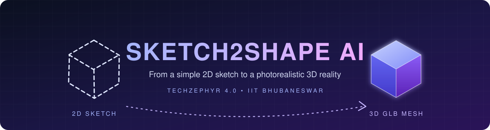
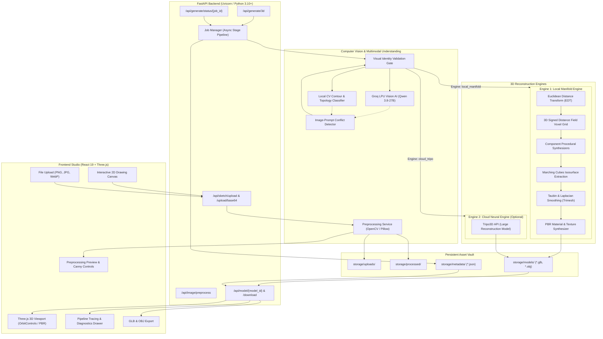

<div align="center">



<br/>

### Draw it. Upload it. Hold it in 3D.
**Watertight, production-ready 3D meshes from rough 2D sketches — no GPU required.**

<br/>

[](https://fastapi.tiangolo.com)
[](https://react.dev)
[](https://threejs.org)
[](https://python.org)

[](https://opencv.org)
[](https://vitejs.dev)
[](https://trimesh.org)
[](#-testing--verification)
[](#-hardware-requirements)
[](LICENSE)
[](#-hackathon-alignment)

<br/>

[**The Idea**](#-the-idea-in-30-seconds) ·
[**Why It's Different**](#-why-its-different) ·
[**Features**](#-features) ·
[**Architecture**](#-high-level-architecture) ·
[**Quick Start**](#-quick-start) ·
[**Benchmarks**](#-benchmarks) ·
[**API**](#-rest-api)

</div>

---

## 🎬 The Idea in 30 Seconds

```text
   ✏️  Draw or upload          🔍  Understand               🧱  Reconstruct              📦  Export
 ┌───────────────────┐     ┌────────────────────┐     ┌──────────────────────┐     ┌──────────────────┐
 │ Canvas / PNG / JPG│ ──▶ │ Otsu + Canny + AI  │ ──▶ │ SDF → Marching Cubes │ ──▶ │ .GLB with PBR    │
 │ WebP sketch       │     │ Visual Identity Gate│     │ → Taubin smoothing   │     │ .OBJ geometry    │
 └───────────────────┘     └────────────────────┘     └──────────────────────┘     └──────────────────┘
```

**SKETCH2SHAPE AI** is a computer vision and generative 3D platform that converts rough hand-drawn sketches and concept art into **watertight 2-manifold meshes** with **multi-colour PBR materials**, viewable instantly in an interactive WebGL studio and exportable to Blender, Unity, or Unreal.

It tackles the classic **ill-posed single-view 3D reconstruction problem** with a **dual-engine architecture**:

|  | ⚙️ **Engine 1 — Local Manifold SDF** | ☁️ **Engine 2 — Cloud Neural (optional)** |
|---|---|---|
| **Type** | Procedural + mathematical reconstruction | Large Reconstruction Model via Tripo3D API |
| **Runs on** | Any laptop, fully offline | Cloud (needs `TRIPO_API_KEY`) |
| **GPU needed** | **None** | None locally |
| **Strength** | Deterministic, watertight, component-aware PBR | Complex freeform geometry |
| **Speed (benchmarked)** | **1.45 – 3.12 s** | Provider-dependent |

---

## 🎯 Problem Statement

> *"Create an AI-driven solution that transforms simple 2D sketches or drawings into fully realized, interactive 3D models. The solution should bridge the gap between creative ideation and 3D design, allowing artists, engineers, and hobbyists to instantly visualize concepts in three dimensions."*
>
> — **TECHZEPHYR 4.0, IIT Bhubaneswar**

### The four walls we had to break through

| 🧱 Challenge | 💥 Why it hurts | ✅ How SKETCH2SHAPE AI solves it |
|---|---|---|
| **Depth ambiguity** | A flat drawing has no *z*-axis; inferring volume is an under-constrained inverse problem | Euclidean Distance Field lifted into a continuous 3D Signed Distance Field |
| **Topological integrity** | Extrusions give open boundaries, inverted normals, non-manifold edges, useless for 3D printing or game engines | Marching Cubes + Taubin smoothing + programmatic watertight verification |
| **Prompt hijacking** | Generative models let text override the sketch (draw a house, mention a chair, get a chair) | **Strict Image-First Policy** + Visual Identity Validation Gate |
| **Compute barrier** | SOTA neural pipelines need 8–16 GB VRAM NVIDIA GPUs | Zero-GPU local engine, with cloud as an *option*, not a requirement |

---

## 💎 Why It's Different

<table>
<tr>
<td width="33%" valign="top">

### 🔒 Image-First, Always
Your drawing **anchors** the silhouette, structure, and component topology. Text prompts only steer **colours, materials, and style**. A programmatic **Visual Identity Gate** stops hallucination and prompt hijacking, so a car sketch with a radiator grille never becomes a house.

</td>
<td width="33%" valign="top">

### 💧 Watertight by Mathematics
Not "looks closed", **provably closed**. Every export is checked for zero boundary edges, Euler characteristic, and `is_watertight == True` before you can download it.

</td>
<td width="33%" valign="top">

### 🪶 Runs Anywhere
No CUDA. No 16 GB VRAM. Benchmarked on an **Intel Core i5 with 8 GB RAM and 0 dedicated GPU**, with full 3D generation in under 3.5 seconds.

</td>
</tr>
</table>

---

## ✨ Features

### 🖌️ Input & Understanding
- **Interactive 2D canvas**: variable brush sizes, smoothing, eraser, clear/reset, direct base64 export to the pipeline
- **Smart preprocessing**: contrast normalization, Otsu adaptive thresholding, background isolation, Canny edges with **live contour feedback**
- **Multimodal vision reasoning**: `qwen/qwen3.8-27b` on **Groq LPUs** extracts semantic parts, aspect ratios, thicknesses, and symmetry planes
- **Local CV fallback**: offline OpenCV classifier using contour circularity, rectangular aperture count, aspect ratio, and bilateral symmetry
- **Visual Identity Validation Gate**: blocks vision hallucination and prompt hijacking

### 🧱 Six Procedural Reconstruction Paradigms

| Archetype | What gets built |
|---|---|
| 🚗 **Vehicles** | Aerodynamic bodies; vintage front-view assemblies with curved bonnets, **14-bar chrome grilles**, glass headlights, overrider bumpers, split windshields, **4 white-wall wheels** with chrome hubcaps |
| 🏠 **Architecture** | Two-storey homes with concrete foundations, stucco siding, gabled eaves, multi-pane windows, covered porches with cylindrical columns, railings, steps, hardwood doors, attached garage wings |
| 🐭 **Organic creatures** | Volumetric quadrupeds with cranial tapering, pink snouts and ears, dual cornea eyes, articulated limbs, paws, curved tails |
| ☕ **Radial vessels** | Lathe-rotation geometry with **hollow fluid cavities**, interior walls, ergonomic handles (mugs, cups, bottles, vases) |
| 🪑 **Furniture** | Planar seats, table tops, backrests, 4-leg frames with crossbars (chairs, tables, stools) |
| ✏️ **Axial tools** | Coaxial cylinders, conical graphite tips, ferrules, erasers (pencils, pens) |

### 🎨 Studio & Export
- **Multi-colour PBR materials**: semantic component mapping exports real glTF parameters (base colour, metallic, roughness, vertex colours)
- **Three.js 3D studio**: OrbitControls, studio lighting, grid plane, bounding-box diagnostics, **PBR / Normals / Wireframe** view toggles
- **Pipeline tracing drawer**: live SHA-256 image hashes, preprocessed hashes, vision model used, detected components, prompt conditioning, provider task IDs, GLB verification hashes
- **Dual export**: binary **`.glb`** (embedded PBR) or Wavefront **`.obj`**

---

## 🏗 High-Level Architecture

The following diagram illustrates the complete end-to-end data flow of SKETCH2SHAPE AI:



<details>
<summary><b>📂 Project directory structure</b> (click to expand)</summary>

```text
SKETCH2SHAPE-AI/
├── .env.example                   # Environment configuration template
├── requirements.txt               # Pinned Python backend dependencies
├── LICENSE · CONTRIBUTING.md · CHANGELOG.md · SECURITY.md
├── pytest.ini
├── verify_fresh_sketches.py       # End-to-end verification for fresh sketches
│
├── backend/                       # FastAPI backend
│   ├── main.py                    # App factory, CORS, static mounts, routers
│   ├── core/
│   │   ├── config.py              # Pydantic Settings & env loader
│   │   └── storage.py             # StorageManager (uploads, models, metadata)
│   ├── models/schemas.py          # Request/response contracts, geometry metrics
│   ├── routers/
│   │   ├── health.py              # /api/health hardware diagnostics
│   │   ├── upload.py              # /api/sketch/upload (+ /base64)
│   │   ├── preprocess.py          # /api/image/preprocess
│   │   ├── generate.py            # /api/generate/3d, /status/{job_id}
│   │   ├── models.py              # /api/model/{model_id}, /download
│   │   └── history.py             # /api/history
│   ├── services/
│   │   ├── preprocess_service.py  # Stroke normalization, Otsu, Canny
│   │   ├── groq_service.py        # Groq Vision AI, local CV classifier, conflict resolver
│   │   ├── job_manager.py         # Async queue, 8-stage tracker, identity gate
│   │   ├── mesh_service.py        # Volume, watertightness checks
│   │   ├── reconstruction_service.py  # SDF, Marching Cubes, procedural generators
│   │   └── cloud_ai_service.py    # Tripo3D & Meshy integrations
│   └── tests/                     # Pytest suite (API, services, SDF regression,
│                                  #   universal reconstruction, image-first conflicts)
│
├── frontend/                      # React 19 + TypeScript + Three.js
│   └── src/
│       ├── App.tsx · main.tsx · index.css
│       ├── services/api.ts        # API client
│       └── components/studio/
│           ├── Header.tsx · SketchCanvas.tsx · ImageUploader.tsx
│           ├── PreprocessView.tsx · GenerationControls.tsx
│           ├── Viewer3D.tsx · ModelHistory.tsx · MetricCard.tsx
│
└── storage/                       # Local file vault
    ├── uploads/ · processed/ · models/ · metadata/
```

</details>

---

## 🚀 Quick Start

> **Prerequisites:** Python `3.10+` · Node.js `18+` · `pip` & `npm`
>
> **No API keys needed.** Without them, the app runs 100% offline using the built-in Local CV Classifier and Local Manifold Engine.

<table>
<tr>
<td width="50%" valign="top">

#### 🪟 Windows (PowerShell)
```powershell
git clone https://github.com/Rohit25-git/SKETCH2SHAPE-AI.git
cd SKETCH2SHAPE-AI

python -m venv venv
.\venv\Scripts\Activate.ps1
pip install -r requirements.txt

Copy-Item .env.example .env

$env:PYTHONPATH='.'
python -m uvicorn backend.main:app `
  --host 127.0.0.1 --port 8000 --reload
```

</td>
<td width="50%" valign="top">

#### 🐧 Linux / 🍎 macOS
```bash
git clone https://github.com/Rohit25-git/SKETCH2SHAPE-AI.git
cd SKETCH2SHAPE-AI

python3 -m venv venv
source venv/bin/activate
pip install -r requirements.txt

cp .env.example .env

export PYTHONPATH='.'
uvicorn backend.main:app \
  --host 127.0.0.1 --port 8000 --reload
```

</td>
</tr>
</table>

**Then, in a second terminal, start the studio:**
```bash
cd frontend
npm install
npm run dev
```

| 🌐 Studio | 📖 API Docs |
|---|---|
| **http://localhost:5173** | **http://127.0.0.1:8000/docs** |

<details>
<summary><b>⚙️ Environment variables</b> (click to expand)</summary>

| Variable | Default | Description |
|---|---|---|
| `PROJECT_NAME` | `"SKETCH2SHAPE AI"` | Application display name |
| `VERSION` | `"1.0.0"` | Semantic version |
| `HOST` / `PORT` | `127.0.0.1` / `8000` | Backend binding |
| `DEFAULT_ENGINE` | `"local_manifold"` | `local_manifold` or `cloud_tripo` |
| `GROQ_API_KEY` | `""` | *Optional.* Groq LPU Vision AI |
| `TRIPO_API_KEY` | `""` | *Optional.* Tripo3D cloud reconstruction |
| `MESHY_API_KEY` | `""` | *Optional.* Meshy 3D generation |
| `MAX_UPLOAD_SIZE_MB` | `10` | Max upload size |

</details>

---

## 🕹 How to Use It

| # | Step | What you do |
|:-:|---|---|
| **1** | ✏️ **Draw or Upload** | Sketch on the canvas and click *Use Sketch*, or drop a PNG / JPG / JPEG / WebP |
| **2** | 🔍 **Inspect** | Check the extracted contours; nudge the threshold slider for faint pencil strokes |
| **3** | 🎛️ **Condition** | *(Optional)* add a prompt like *"vintage red sports car with chrome trim"*. Pick **Local Manifold** or **Cloud Tripo3D**, a resolution (`Fast` / `Standard` / `Ultra`), and smoothness (1–5) |
| **4** | 🔬 **Explore** | Watch the 8-stage tracker, then orbit (left-click), pan (right-click), zoom (scroll). Toggle **PBR / Normals / Wireframe** |
| **5** | 📦 **Export** | **Download GLB** for Blender / Unity / Unreal, or **Download OBJ** for raw geometry |

<!--
📸 UNCOMMENT AFTER ADDING YOUR SCREENSHOTS TO assets/screenshots/

<div align="center">
  
  <br/><sub><b>The Studio:</b> canvas, preprocessing, and live 3D viewport</sub>
</div>

| Input Sketch | Generated 3D Mesh |
|:-:|:-:|
|  |  |
-->

---

## 🧮 The Math Behind the Magic

<details open>
<summary><b>From flat pixels to a watertight mesh in five steps</b></summary>

**① Euclidean Distance Transform.** For a binary silhouette mask $B(x,y)$, distance to the nearest background pixel:

$$D(x, y) = \min_{(u, v) \notin B} \sqrt{(x - u)^2 + (y - v)^2}$$

**② Volumetric Signed Distance Field.** Depth is modulated by $D(x,y)$ across a voxel grid, which avoids box-like extrusion:

$$\Phi(x, y, z) = D(x, y) - \sqrt{z^2 + \epsilon}$$

$\Phi > 0$ is inside the volume and $\Phi < 0$ is outside. Internal strokes (creases, panel lines) locally modulate the field to carve surface relief.

**③ Marching Cubes.** The zero-crossing surface $S = \{(x,y,z) \mid \Phi = 0\}$ is extracted with Lorensen–Cline Marching Cubes (`skimage.measure.marching_cubes`).

**④ Taubin + Laplacian smoothing.** Non-shrinking smoothing removes voxel staircase artifacts:

$$v_i^{(k+1)} = v_i^{(k)} + \lambda \sum_{j \in \mathcal{N}(i)} w_{ij}\,(v_j^{(k)} - v_i^{(k)})$$
$$v_i^{(k+2)} = v_i^{(k+1)} + \mu \sum_{j \in \mathcal{N}(i)} w_{ij}\,(v_j^{(k+1)} - v_i^{(k+1)})$$

with $0 < \lambda < -\mu$ so the volume does not shrink. Normals are recomputed from area-weighted face normals.

**⑤ Watertight verification before export:**

| Check | Requirement |
|---|---|
| Euler characteristic | $\chi = V - E + F = 2(1 - g)$ |
| Boundary edges | Exactly **0** (every edge shared by exactly 2 faces) |
| Watertightness | `mesh.is_watertight == True` |

</details>

---

## 📊 Benchmarks

> Measured on a standard Windows workstation: **Intel Core i5 · 8 GB RAM · 0 dedicated GPU**, using the default **Local Manifold Engine**.

| Archetype | Vertices | Triangles | Manifold | Watertight | PBR Components | ⏱ Time |
|---|--:|--:|:-:|:-:|---|--:|
| 🚗 **Vintage Car** (front view) | 13,690 | 27,136 | ✅ | ✅ | 61 · body, grille, lights, bumper, wheels | **2.84 s** |
| 🏠 **Two-Storey House** | 16,842 | 32,410 | ✅ | ✅ | 48 · siding, roof, porch, windows, garage | **3.12 s** |
| 🐭 **Organic Creature** (rat) | 12,418 | 24,680 | ✅ | ✅ | 10 · fur, belly, snout, ears, paws, tail | **2.45 s** |
| ☕ **Coffee Mug** | 8,924 | 17,840 | ✅ | ✅ | 3 · glazed body, cavity, handle | **1.82 s** |
| 🪑 **Wooden Chair** | 11,250 | 22,100 | ✅ | ✅ | 6 · seat, backrest, 4 legs | **2.10 s** |
| ✏️ **Drafting Pencil** | 6,480 | 12,912 | ✅ | ✅ | 5 · shaft, collar, graphite, ferrule, eraser | **1.45 s** |

**6 / 6 archetypes watertight · 6 / 6 manifold · every model under 3.5 s on CPU only.**

---

## 🔍 Technical Honesty

We believe judges deserve a straight answer about what runs where.

> **⚙️ Engine 1 (Local Manifold SDF)** is a **procedural and mathematical** reconstruction system. It combines computer vision, topological skeleton analysis, signed distance fields, Marching Cubes, and component-aware PBR mapping. It does **not** run a local PyTorch neural network or diffusion model.
>
> **☁️ Engine 2 (Cloud Neural)** is an **AI-native generative** system using the Tripo3D API. With a `TRIPO_API_KEY`, it performs neural Large Reconstruction Model inference.
>
> Procedural output from Engine 1 is **never** falsely attributed as neural output. Both engines produce valid, downloadable GLB models.

---

## 🧰 Tech Stack

<details>
<summary><b>Verified versions</b> (click to expand)</summary>

| Layer | Technology | Version | Role |
|---|---|---|---|
| **Backend** | FastAPI | `0.162.0` | Async REST API |
| | Uvicorn | `0.54.0` | ASGI server |
| | Pydantic | `2.14.2` | Validation & serialization |
| | HTTPX | `0.28.1` | Async calls to Groq / Tripo3D |
| | psutil | `7.2.2` | Hardware telemetry |
| | Pytest | `9.2.0` | Test suite |
| **Vision & Geometry** | OpenCV Headless | `5.0.0.93` | Canny, contours, thresholding |
| | Pillow | `12.3.0` | Image I/O |
| | SciPy | `1.15.3` | `distance_transform_edt` |
| | Scikit-Image | `0.25.2` | Marching Cubes |
| | NumPy | `2.2.6` | Voxel grids |
| | Trimesh | `5.2.0` | Meshes, Taubin smoothing, GLB export |
| | Shapely | `2.1.2` | Contour polygon geometry |
| **Frontend** | React | `19.3.1` | UI & state |
| | TypeScript | `5.9.3` | Type safety |
| | Vite | `8.3.5` | Bundler |
| | Three.js | `0.187.0` | WebGL rendering |
| | @react-three/fiber | `9.8.2` | Declarative Three.js |
| | @react-three/drei | `10.7.9` | Controls, lighting helpers |
| | Tailwind CSS | `4.3.3` | Dark studio theme |
| | Lucide React | `1.16.0` | Icons |

</details>

---

## 🔌 REST API

Interactive OpenAPI docs live at **`http://127.0.0.1:8000/docs`**.

| Method | Endpoint | Purpose |
|:-:|---|---|
| `GET` | `/api/health` | Server health, hardware metrics, available engines |
| `POST` | `/api/sketch/upload` | Multipart sketch upload → `image_id`, dimensions |
| `POST` | `/api/sketch/upload/base64` | Canvas export upload |
| `POST` | `/api/image/preprocess` | Threshold + edge detection → `processed_id`, `contours_detected`, `coverage_ratio` |
| `POST` | `/api/generate/3d` | Start generation → `job_id`, `model_id` |
| `GET` | `/api/generate/status/{job_id}` | Stage, progress %, elapsed seconds |
| `GET` | `/api/model/{model_id}` | Geometry metrics + identity tracing metadata |
| `GET` | `/api/model/{model_id}/download?format=glb\|obj` | Stream GLB (`model/gltf-binary`) or OBJ |
| `GET` | `/api/history` | List generated models |
| `DELETE` | `/api/history/{model_id}` | Delete a model and its assets |

<details>
<summary><b>Example: generate a 3D model</b></summary>

```http
POST /api/generate/3d
Content-Type: application/json

{
  "image_id": "...",
  "prompt": "vintage car",
  "engine": "local_manifold",
  "resolution": "standard",
  "smoothness": 3,
  "conflict_resolution": "preserve_image"
}
```

</details>

---

## ✅ Testing & Verification

```bash
# Backend: Linux / macOS
export PYTHONPATH='.' && pytest backend/tests/ -v

# Backend: Windows PowerShell
$env:PYTHONPATH='.'; .\venv\Scripts\python -m pytest backend/tests/ -v

# Frontend: strict TypeScript + production build
cd frontend && npm run build
```

- **46 automated backend tests** covering API routes, preprocessing, SDF and mesh metrics, manifold regression, multi-paradigm reconstruction, and image-first conflict resolution
- **Clean TypeScript build** with 0 compiler or bundler errors

---

## 💻 Hardware Requirements

| | Minimum | Recommended |
|---|---|---|
| **OS** | Windows 10/11 · Ubuntu 20.04+ · macOS 12+ | Windows 11 / Ubuntu 22.04 LTS |
| **CPU** | Dual-core x86_64 or Apple Silicon | Quad-core i5/i7, Ryzen 5+, Apple M-series |
| **RAM** | 4 GB | 8 GB+ |
| **GPU** | **None** | Not needed for the Local Engine |
| **Disk** | 500 MB | 2 GB |
| **Browser** | Chrome 90+ · Firefox 88+ · Safari 15+ · Edge 90+ | Latest Chrome/Brave with WebGL 2.0 |

---

## ⚖️ Known Trade-offs

- **Single-view rear ambiguity:** for a front-elevation sketch, rear features (bumper, rear windows) are mirrored or synthesized from bilateral symmetry.
- **Resolution vs. time:** the default voxel grid ($128^3$ to $180^3$) keeps generation under ~3.5 s; Ultra ($256^3$) adds detail but takes proportionally longer on low-spec CPUs.
- **Abstract scribbles:** sketches without discernible closed contours fall back to a universal harmonic manifold pipeline, so you always get a valid closed mesh instead of an error.

---

## 🏆 Hackathon Alignment

| TECHZEPHYR 4.0 Requirement | Our Implementation |
|---|---|
| ✏️ **2D sketch input** | Interactive browser canvas plus multi-format drag-and-drop upload |
| 🧊 **3D realization** | Continuous SDF, Marching Cubes, multi-component procedural assemblies |
| 🎮 **Interactive visualization** | Three.js viewport with OrbitControls, PBR materials, wireframe overlay |
| 📦 **Exportable assets** | Binary glTF (`.glb`) with embedded PBR materials, plus Wavefront (`.obj`) |
| 🤖 **AI/ML innovation** | Multimodal Vision AI (`qwen/qwen3.8-27b` on Groq LPU), Visual Identity Gate, optional neural LRM engine |
| 🛠️ **Engineering rigor** | 46 backend tests, strict TypeScript build, documented REST API, watertight verification |

---

## 👥 Team

<div align="center">

### 🏛️ The Chanakya

*Strategy meets engineering.*

Built for **TECHZEPHYR 4.0** at the **Indian Institute of Technology (IIT) Bhubaneswar**.

</div>

### 🙏 Acknowledgements
**IIT Bhubaneswar** for organizing TECHZEPHYR 4.0 · **Groq Inc.** for low-latency LPU vision inference · **Three.js & Poimandres** for `@react-three/fiber` and `drei` · **Trimesh & Scikit-Image** for the geometry stack.

---

## 📜 License & Contact

Released under the **MIT License**. See [LICENSE](LICENSE).

- 🐛 **Issues:** [github.com/Rohit25-git/SKETCH2SHAPE-AI/issues](https://github.com/Rohit25-git/SKETCH2SHAPE-AI/issues)
- 📦 **Repository:** [github.com/Rohit25-git/SKETCH2SHAPE-AI](https://github.com/Rohit25-git/SKETCH2SHAPE-AI)

<br/>

<div align="center">

**⭐ If SKETCH2SHAPE AI impressed you, star the repo! ⭐**

<sub>Built by <b>The Chanakya</b> with precision and passion for TECHZEPHYR 4.0 &bull; IIT Bhubaneswar</sub>

</div>
